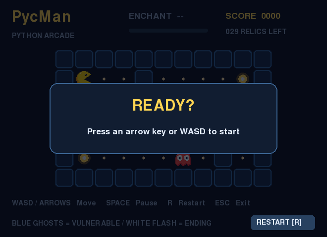
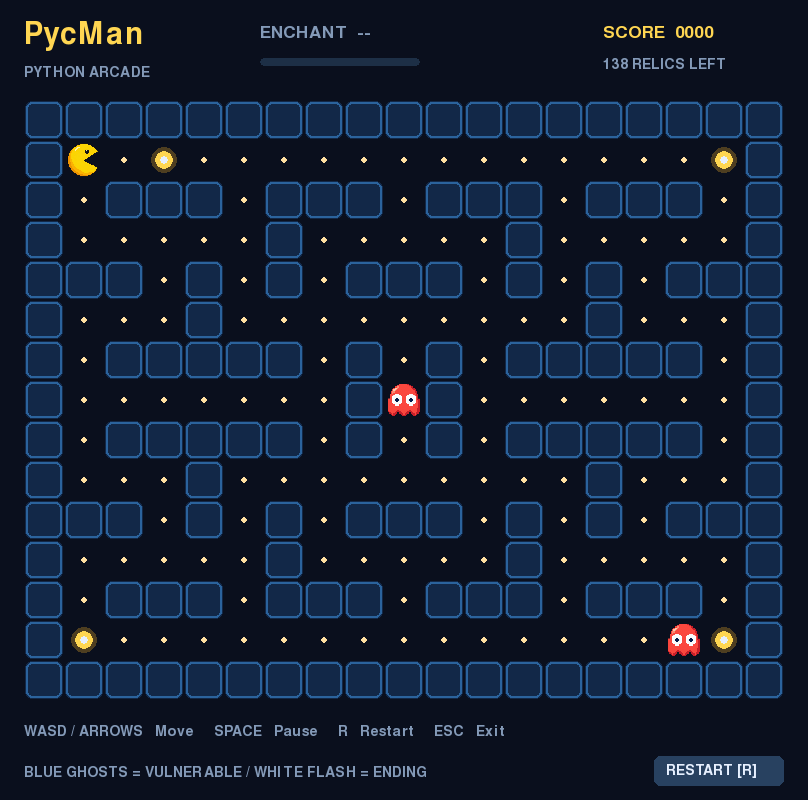

# Essential Background Knowledge · 预备知识

> “Begin at the beginning,” the King said gravely, “and go on till you come to the end: then stop.”
>
> “从开头讲起，”国王郑重地说，“一直讲到结尾，然后停下来。”（译文）
> ——〔英〕Lewis Carroll，[《爱丽丝漫游奇境》第十二章](https://www.gutenberg.org/files/11/11-h/11-h.htm#chap12)

在上手完成作业之前，我们先介绍一下运行环境、测试、版本管理和代码结构；各阶段的具体要求请阅读[《学生任务说明》](student-assignment.md)。不必一次读懂所有框架代码，可以在完成任务时按需查阅。

## 环境管理

Python 解释器负责运行程序，第三方包提供额外功能，虚拟环境则让不同项目各自使用一套依赖，减少版本冲突。环境建好后，项目源码仍放在项目目录中，不要放进环境目录。

本项目需要 **Python 3.10 或更新版本**。以下三种方式任选一种即可；已有 conda 的同学可以继续使用 conda，已经安装 Python 的同学可以从 venv 开始，熟悉 uv 的同学也可以使用 uv。以下命令均在项目根目录（包含 `requirements.txt` 的目录）执行。

### conda：同时管理 Python 与依赖

conda 可以创建使用指定 Python 版本的独立环境。安装好 conda 后，在支持 conda 的终端中执行：

```bash
conda create -n pycman python=3.11 pip
conda activate pycman
python -m pip install -r requirements.txt
```

这里的 `pycman` 是环境名称，`python=3.11` 是本例选择的解释器版本。每次打开新终端后，先执行 `conda activate pycman` 再运行项目；退出环境用 `conda deactivate`。Windows 用户可以使用安装工具提供的 Anaconda Prompt；若普通终端提示需要初始化，请按提示为所用 shell 执行 `conda init`，再重新打开终端。参见 [conda 环境管理文档](https://docs.conda.io/projects/conda/en/stable/user-guide/tasks/manage-environments.html)。

### venv：使用 Python 自带的虚拟环境

venv 基于已有的 Python 解释器创建环境，不会替你选择或安装另一个 Python 版本。先检查版本，再创建项目环境：

```bash
python --version
python -m venv .venv
```

如果系统使用 `python3` 命令，上面两条命令都改用 `python3`；Windows 上也可用 `py -3.11 -m venv .venv` 指定已经安装的 Python 3.11。

根据终端类型激活环境：

| 终端 | 激活命令 |
| --- | --- |
| Windows PowerShell | `.\.venv\Scripts\Activate.ps1` |
| Windows 命令提示符（cmd） | `.venv\Scripts\activate.bat` |
| macOS / Linux 的 bash 或 zsh | `source .venv/bin/activate` |

激活后安装依赖：

```bash
python -m pip install -r requirements.txt
```

每次打开新终端都需要重新激活；退出环境用 `deactivate`。激活的作用是让终端优先找到环境里的解释器。如果 PowerShell 禁止运行激活脚本，也可以直接使用 `.\.venv\Scripts\python.exe` 替代后文命令中的 `python`，无需修改系统策略。详见 [Python venv 文档](https://docs.python.org/3/library/venv.html)。

### uv：快速创建环境与安装依赖

uv 是独立安装的 Python 工具，可创建虚拟环境并安装依赖。按 [uv 安装说明](https://docs.astral.sh/uv/getting-started/installation/) 安装后，执行：

```bash
uv venv --python 3.11 .venv
uv pip install --python .venv -r requirements.txt
```

随后按上面的 venv 表格激活 `.venv`，用 `python` 运行项目。uv 创建的环境默认不一定包含 pip，因此后续如果需要额外安装 pytest，使用 `uv pip install --python .venv pytest`。本项目已经提供 `requirements.txt`，不需要先执行 `uv init`。环境用法见 [uv 官方文档](https://docs.astral.sh/uv/pip/environments/)。

### 确认终端和编辑器使用同一个环境

安装完成后，在已激活的环境中检查：

```bash
python -c "import sys; print(sys.executable); print(sys.version)"
python -c "import pygame; print(pygame.__file__)"
```

第一条显示实际使用的解释器路径与版本，第二条确认游戏依赖能够导入。编辑器也应选中同一个解释器，否则可能出现“终端能运行，编辑器却提示缺少模块”的情况。`.venv/` 是可重建的本地环境，不应提交到 Git；项目依赖以 `requirements.txt` 为准。

## pygame 与 pygame-ce：让游戏出现在屏幕上


pygame 是用于制作游戏和多媒体程序的 Python 库，提供窗口、图像绘制、键盘鼠标输入、声音播放和计时等功能。pygame-ce 是它的社区版本（Community Edition），本项目使用 pygame-ce。安装时的包名是 `pygame-ce`，代码里仍然写 `import pygame`。可用接口和入门示例见 [pygame-ce 官方文档](https://pyga.me/docs/)。

PycMan 的图形界面（GUI）在 `src/gui.py` 中。它反复完成三件事：接收键盘等事件、在适当时机推进游戏、绘制当前画面。窗口和绘制已经由框架提供，你主要负责补充游戏规则与控制逻辑。

### 准备环境与启动

完成上面的任意一种环境配置后，在已激活环境的项目根目录运行：

```bash
python src/main.py --stage S1
```



*图 1：S1 的初始窗口。窗口能够打开，说明界面可以运行；角色移动等效果会随着任务完成逐步出现。*

方向键或 WASD 用于移动，空格或 P 暂停与继续，R 重开，Esc 退出。窗口失去焦点后会自动暂停，返回窗口时可按空格继续。将命令中的 `S1` 改为 `S2`～`S5`，即可运行相应阶段。

### 画面刷新与游戏回合

**一帧画面不等于一个游戏回合。** GUI 以每秒 60 帧为目标刷新画面，游戏则按照配置中的 `turn_ms` 间隔推进。角色位置、分数和无敌剩余时间按回合更新；暂停期间画面仍可显示，但游戏不推进。

这个区别有助于理解调试现象：无敌时间的单位是“回合”，不是绘制次数；角色尝试撞墙或等待，也可能让一回合过去。

## 自动测试：unittest 与 pytest

手动游玩适合观察整体效果，自动测试适合反复检查明确的行为。例如，给定一张小地图和一个动作，可以检查角色位置是否符合预期。这样的检查能在修改代码后快速发现旧功能是否受到影响。

测试驱动开发（TDD）通常采用“先写一个描述预期行为的测试，看到它失败，再实现功能使它通过，最后整理代码”的循环。作业已经提供了公开测试；你也可以为自己遇到的问题补充小例子，将调试过程变成可重复的检查。

### 本项目怎样运行测试

本项目的测试使用 Python 标准库 **unittest** 编写，统一入口是 `python -m tests`，无需另装测试库。请在项目根目录运行：

```bash
python -m tests framework
python -m tests S1
python -m tests S3
python -m tests all
```

| 参数 | 检查内容 |
| --- | --- |
| `framework` | 只检查框架是否正常 |
| `S1`～`S5` | 先检查框架，再检查从 S1 到指定阶段的任务与累计游戏行为 |
| `all` | 检查框架与全部基础阶段，不包含进阶题 |
| `A1` 等进阶编号 | 先检查框架与完整基础游戏，再检查指定的进阶题；可同时指定多题，如 `A1 B2` |

测试会检查单个接口，也会把接口放回游戏中，检查它们能否一起工作。未完成任务时出现失败是正常的，可以先关注当前阶段。

阅读输出时，`FAIL` 通常表示实际结果不符合断言，`ERROR` 表示测试执行时发生了异常。先找到失败的测试名称，再看回溯最后的异常信息和相关代码位置，结合输入地图比较“预期状态”与“实际状态”。只看到一个总分，往往不足以判断问题出在哪里。

### pytest 是什么

[pytest](https://docs.pytest.org/en/stable/) 是另一个常用的 Python 测试工具，支持直接用 `assert` 编写测试、按名称筛选测试，并提供较直观的失败信息。它也能运行许多 [unittest 风格的测试](https://docs.pytest.org/en/stable/how-to/unittest.html)。

如果希望用它辅助定位某个公开测试，可在当前虚拟环境中额外安装并运行：

```bash
python -m pip install pytest
python -m pytest tests/test_basic.py -k test_s1_walkability -v
```

这里的 `-k` 按名称筛选，`-v` 显示详细结果。此命令适合单独调试；作业的阶段检查、累计检查和计分仍使用 `python -m tests`。

## Git：为开发过程留下记录

Git 是分布式版本控制工具。即使没有网络，你也可以在本地记录版本、比较差异和查看历史。GitHub、GitLab 等平台则提供远程仓库托管。

它把一次提交（commit）保存为项目的一个版本，让你能比较修改、查找问题出现的时间，并回顾自己的实现过程。保存文件只是更新工作区，提交则是把选定的修改记入版本历史。

开发时，每完成一个可描述的小步骤就提交一次，例如“完成 S1 并验证边界行为”或“记录转弯异常的复现场景”。提交说明应表达这次修改的目的。基本概念和完整教程可查阅 [Pro Git 中文版](https://git-scm.com/book/zh/v2)以及 [GitHub 入门文档](https://docs.github.com/zh/get-started)。

### 从本地仓库开始

第一次使用 Git 时，设置提交者信息，将示例替换为自己的姓名和邮箱：

```bash
git config --global user.name "Your Name"
git config --global user.email "you@example.com"
```

如果从压缩包解压得到项目，在项目根目录执行一次 `git init`；如果通过 `git clone` 获取项目，它已经是 Git 仓库。初始化后可先提交一份起始版本。用 `git status` 查看文件，并检查 `.gitignore` 已排除 `.venv/`、`__pycache__/` 等本地生成内容。

日常的一次提交可以这样进行：

```bash
git status
git diff
git add src/tasks/basic/s1.py
git diff --staged
git commit -m "完成 S1 并检查边界行为"
git log --oneline -5
```

其中，`git diff` 查看尚未暂存的修改；`git add` 将文件的当前修改放入暂存区；`git diff --staged` 检查准备提交的内容；`git commit` 保存这次版本。继续修改同一文件后，需要再次 `git add` 才会把新改动纳入下一次提交。

### 托管平台与 GitHub CLI

Git 可以完全在本地使用，代码托管平台则用于远程保存和协作。常见选择包括：

| 平台 | 简介 |
| --- | --- |
| [GitHub](https://github.com/) | 托管 Git 仓库，提供议题（Issue）、代码审查等协作功能，也常用于查阅开源项目 |
| [GitLab](https://about.gitlab.com/) | 提供代码托管与协作服务，也支持自行部署；学校或团队可能使用独立的 GitLab 站点 |
| [Gitee](https://gitee.com/) | 国内的 Git 代码托管与研发协作平台 |

按课程要求和自己的网络访问情况选择平台。`commit` 保存在本地，`push` 才会把提交上传到远程仓库；作业仓库的可见性与提交方式以课程要求为准。

`gh` 是可选的 GitHub 命令行工具，需要单独安装。它能完成登录、克隆和打开仓库网页等操作；普通的修改和提交仍使用 Git。例如，将下面的 `OWNER/REPO` 替换为实际仓库：

```bash
gh auth login
gh repo clone OWNER/REPO
```

进入克隆后的项目目录，可以用 `gh browse` 打开仓库网页。更多用法见 [GitHub CLI 手册](https://cli.github.com/manual/)。

## PycMan：从迷宫认识代码

石门在身后合拢，神器碎片散落在迷宫深处，幽灵正在通道间游荡。你需要拾取所有神器碎片和附魔晶石，并在追捕中存活。附魔晶石能带来短暂的反击机会，但它的力量会随着回合消退。

PycMan 将迷宫游戏拆成一组逐步接入的编程任务：从移动和拾取开始，再加入碰撞、幽灵行为与键盘控制，最后扩展道具、追逐策略或地图机制。



*图 2：街机地图的界面示意。黄色角色是玩家，红色角色是幽灵，小亮点是神器碎片，大光球是附魔晶石。顶部显示分数、剩余收集物和附魔状态；各阶段默认使用的地图可能不同。*

### 文件放在哪里

下面列出学习时最常用的目录与文件：

```text
PycMan/
├── Background.md          # 背景知识与工具入门
├── requirements.txt       # Python 依赖
├── src/
│   ├── main.py            # 启动入口，读取命令行参数
│   ├── gui.py             # 窗口、输入事件与画面绘制
│   ├── game.py            # 组装游戏、推进回合、分发事件
│   ├── utils.py           # 地图环境与角色对象
│   ├── controller.py      # 键盘与幽灵控制器
│   ├── rules.py           # 按阶段连接任务接口
│   ├── codebook.py        # 地图字符与地形常量
│   ├── config.py          # 配置类型与读取逻辑
│   └── tasks/
│       ├── basic/         # S1～S5 基础任务
│       └── advanced/      # A1～C2 进阶任务
├── configs/               # JSON 配置：地图、分数、回合间隔等
├── assets/
│   ├── maps/              # 文本地图
│   ├── sprites/           # 角色图像
│   └── scenarios/         # 进阶场景配置
├── tests/                 # 自动测试与阶段检查入口
└── imgs/                  # 文档配图
```

开始时先读当前阶段的任务文件，再根据函数参数查阅 `utils.py` 或 `controller.py`。需要了解调用时机时，查看 `game.py`；需要了解一个阶段启用了哪些接口时，查看 `rules.py`。

### 几个核心对象

| 对象 | 作用与常用信息 |
| --- | --- |
| `Env` | 保存地形、地图尺寸、玩家和幽灵；`get_tile(x, y)` 读取地形，`set_tile(x, y, value)` 更新地形 |
| `Agent` | 角色基类，保存 `x`、`y`、`live` 和所在环境 `env` |
| `Player` / `Ghost` | 玩家与幽灵；玩家额外保存分数 `score` 和无敌剩余回合数 `state` |
| `Controller` | 为所控制的 `agent` 选择动作；`get_direction()` 返回方向或等待，也可保存策略所需的状态 |
| `GameRules` | 保存当前阶段使用的规则函数，将框架调用连接到任务实现 |
| `Game` | 组织环境与控制器，用 `step()` 推进一个回合，并维护 `status` 等游戏状态 |
| `GUI` | 接收输入、安排回合更新，把游戏状态绘制到窗口 |

控制器负责“选择动作”，规则负责“执行后发生什么”，GUI 负责“如何显示”。同一个 `Player` 对象会被环境、游戏和控制器引用，因此通过这些入口看到的是同一名玩家的状态。

例如，推进游戏时，`Game` 会向控制器取得动作，再调用角色的移动接口；角色通过 `GameRules` 调用你在任务文件中实现的函数。自动测试也可以直接调用这些接口，因此不用打开窗口也能检查规则。

### 地图、坐标与动作

地图是每行等宽的文本文件，常用字符如下：

| 字符 | 含义 |
| --- | --- |
| `#` | 墙壁 |
| 空格 | 空路 |
| `.` | 神器碎片 |
| `o` | 附魔晶石 |
| `c` | 玩家出生位置，地图中恰有一个 |
| `g` | 幽灵出生位置 |

坐标从左上角的 `(0, 0)` 开始，向右 `x` 增加，向下 `y` 增加。二维列表按“行、列”存储，因此 `(x, y)` 对应 `env.env[y][x]`；通过 `get_tile(x, y)` 读取时则仍按 `x, y` 传参。

**角色位置与地形分开保存。** 地图载入后，`c` 和 `g` 会生成相应角色，出生格变为空路。角色走过一格时，地形中不会写入角色标记；幽灵站在碎片上，也不意味着碎片消失。

动作是位移向量：右 `(1, 0)`、下 `(0, 1)`、左 `(-1, 0)`、上 `(0, -1)`，等待为 `(0, 0)`。这里的 `(0, 0)` 是“不移动”的动作，不是让角色前往左上角。

可以复制一张文本地图，用少量墙壁、通道和收集物构造自己的观察场景，再通过 `--map` 载入。例如：

```bash
python src/main.py --stage S1 --map assets/maps/basic/corridor.txt
```

### 一回合怎样推进

基础功能完整接入后，一回合的主要顺序是：先减少已有的无敌剩余回合数，玩家再移动并拾取，随后检查碰撞与胜负；如果游戏仍在进行，存活幽灵依次行动，每只行动后再次检查碰撞与胜负。

因此，**调用顺序也是规则的一部分**：玩家拾取附魔晶石后，本回合的碰撞检查就能看到新的无敌状态。GUI 的暂停不会推进回合，游戏里的等待动作则会。详细边界条件以各题说明为准。

S1～S5 依次累计启用功能，进阶任务建立在完整基础游戏上。多数进阶任务通过 `install(game, config)` 注册事件回调，在特定时机响应；C1 则通过 `generate_map(width, height, seed)` 提供地图文本。做相应题目时，再阅读任务说明中的事件和参数约定即可。

调试时，优先缩小问题：选一张小地图，记录动作前后的位置、地形、分数和状态，说明自己预期发生什么，再与 GUI 和测试结果比较。这样得到的观察记录，也能直接帮助你撰写实验报告。


### 阅读框架：Env 与 Agent

下面为 [src/utils.py](src/utils.py) 中的两个框架类补充阅读注释。它们展示地图存储、对象引用和规则委托；任务的行为要求仍以[学生任务说明](student-assignment.md)为准。这里省略了文件顶部的导入，代码片段用于对照阅读，不是独立运行的脚本。

阅读前可以先认识几个 Python 写法：

| 写法 | 含义 |
| --- | --- |
| `self` | 当前实例；`self.env` 是保存在这个对象上的属性 |
| `__init__` | 创建实例时初始化其属性的方法 |
| `list[str]`、`tuple[int, int]` | 类型标注，分别表示字符串列表和包含两个整数的元组 |
| `Player | None` | 该值可以是玩家对象，也可以是表示尚未设置的 `None` |
| `-> bool`、`-> None` | 返回值的类型标注；后者表示不返回有意义的结果 |
| 参数中的 `*` | 其后的参数需通过名称传入，例如 `rules=...` |

类型标注帮助理解接口，但不会自动验证传入的值。阅读函数时，还要看它实际做了哪些检查。

#### Env：保存地图与角色

初始化时，`Env` 读取地图、检查行宽、将字符转换为地形编号，再创建角色。`get_tile` 和 `set_tile` 操作地形，`can_walk` 和 `resolve_collisions` 则把行为交给当前规则。

```python
class Env:  # 游戏环境，保存地形和角色
    def __init__(self, path: str | Path | list[str], config: GameConfig = DEFAULT_SETTINGS, *, rules: GameRules | None = None) -> None:
        # 保存配置与当前阶段的规则对象
        self.config = config
        self.rules = rules
        if isinstance(path, list):
            # 列表中的每个字符串代表一行地图
            _env = path
        else:
            # 否则将字符串或 Path 对象视为地图文件路径
            assert os.path.exists(path=path)
            with open(file=path, mode='r', encoding='utf-8') as f:
                _env = f.readlines()
        _env = [_row.rstrip('\r\n') for _row in _env]
        # 只移除行尾换行符；空格也是有效的地图字符
        if not _env or not _env[0]:
            raise ValueError('Map must not be empty')
        self.rows:int = len(_env)
        self.cols:int = len(_env[0])
        self.codebook:dict[str, int] = CODEBOOK.copy()
        self._rev:dict[int,str] = {v:k for k,v in self.codebook.items()}
        # 按 codebook 中的映射将字符转换为整数编号
        self.env: list[list[int]] = []
        for row in _env:
            if len(row) != self.cols:
                raise ValueError('Map rows must have the same width')
            self.env.append([self.codebook[_s] for _s in row])
        # 上面的循环同时检查每一行是否等宽

        self.player:Player|None = None
        self.ghosts:list[Ghost] = []
        # 初始化玩家和幽灵
        self.agentRegistration() # register Agents

    def assert_env(self)->None:
        """
        assert the environment is all right
        """
        # 检查是否地图一切正常
        assert len(self.env) == self.rows
        for row in self.env:
            assert len(row) == self.cols

    def get_tile(self, x: int, y: int) -> int:
        """Coordinates are (x, y): right and down; storage is [row][column]."""
        # x 是列坐标，y 是行坐标；返回地形编号，不返回角色对象
        # 因为存储方式不同，在我们的环境里检索就是 env[y][x]
        if not (0 <= x < self.cols and 0 <= y < self.rows):
            raise IndexError('Tile coordinates are outside the map')
        return self.env[y][x]

    def set_tile(self, x: int, y: int, value: int) -> None:
        """Store terrain/items only. Characters keep their own positions."""
        # 仅写入地形或收集物；不在地形数组中存储角色
        if not (0 <= x < self.cols and 0 <= y < self.rows):
            raise IndexError('Tile coordinates are outside the map')
        if value not in (ROAD, WALL, POINT, POWER):
            raise ValueError('A tile must be ROAD, WALL, POINT or POWER')
        self.env[y][x] = value

    def can_walk(self, x: int, y: int) -> bool:
        # 委托给当前阶段规则；进阶事件还可以调整通行结果
        if self.rules is not None and self.rules.can_walk is not None:
            allowed = self.rules.can_walk(self, x, y)
            game = getattr(self, 'game', None)
            if game is not None:
                allowed = game.emit('can_walk', x=x, y=y, allowed=allowed)['allowed']
            return allowed
        raise RuntimeError('No can_walk rule is configured')

    def update_element(self, x: int, y: int, _type: int) -> None:
        """Compatibility wrapper for existing callers."""
        # 调用 set_tile 的方法
        self.set_tile(x, y, _type)

    def print(self) -> None:
        """Overlay living characters on a temporary display, not on the map."""
        # 将存活角色叠加到临时字符数组后打印，不改变实际地形
        display = [[self._rev[tile] for tile in row] for row in self.env]
        for ghost in self.ghosts:
            if ghost.live:
                display[ghost.y][ghost.x] = ghost.code
        if self.player is not None and self.player.live:
            display[self.player.y][self.player.x] = self.player.code
        for row in display:
            print(''.join(row))

    def agentRegistration(self) -> None:
        """Convert spawn markers into characters standing on ROAD tiles."""
        # 根据出生标记创建角色，再将出生格还原为空路
        for y, row in enumerate(self.env):
            for x, element in enumerate(row):
                if element == PLAYER:
                    if self.player is not None:
                        raise ValueError('Map must contain exactly one player')
                    self.player = Player(x, y, self)
                    self.set_tile(x, y, ROAD)
                elif element == GHOST:
                    self.ghosts.append(Ghost(x, y, self))
                    self.set_tile(x, y, ROAD)
                elif element == AGENT:
                    raise ValueError('Use c or g instead of the generic a marker')
        if self.player is None:
            raise ValueError('Map must contain exactly one player')

    def resolve_collisions(self) -> None:
        # 调用当前阶段的碰撞规则，任务实现位于 tasks 中
        if self.rules is not None and self.rules.resolve_collisions is not None:
            return self.rules.resolve_collisions(self)
        raise RuntimeError('No resolve_collisions rule is configured')
```

#### Agent：保存角色自身的状态

`Agent` 保存坐标、存活状态和环境引用。对一个角色实例 `agent`，可以通过 `agent.env` 找到它所在的环境；`agent.getItem((x, y))` 封装了地形读取。这里应使用实例，而不是通过类名 `Agent.env` 访问环境。

注意区分 `moveForward` 与 `move`：前者直接更新坐标，接收的是目标位置；后者接收方向位移，并交给规则处理合法性与移动行为。只看方法名，容易混淆两者的职责。

```python
class Agent:
    def __init__(self, x:int, y: int, env: Env) -> None:
        # 初始化角色位置、环境引用与存活状态
        self.x:int = x
        self.y:int = y
        self.env:Env = env  # 保存同一个环境对象的引用，不复制地图
        self.code:str = 'a'
        self.live:bool = True

    def getItem(self, pos: tuple[int, int]) -> int:
        # 实际上相当于 self.env.get_tile(*pos)
        """Read terrain/items; characters are not stored in tiles."""
        x, y = pos
        return self.env.get_tile(x, y)

    def moveForward(self, future_pos: tuple[int, int]) -> None:
        """Update position only; move() checks the destination first."""
        # 直接更新坐标，本方法本身不检查目标是否可通行
        self.x, self.y = future_pos

    def move(self, direction: tuple[int, int]) -> bool:
        """Ask the active rules to move this character."""
        # 移动的函数需要同学们在tasks中完成
        if self.env.rules is not None and self.env.rules.move is not None:
            return self.env.rules.move(self, direction)
        raise RuntimeError('No move rule is configured')
```

## 遇到问题时，从哪里开始

| 现象 | 优先检查 |
| --- | --- |
| `No module named pygame` | 运行程序的解释器是否就是安装依赖的环境；用前面的两条检查命令确认 |
| 找不到 `src/main.py` 或 `requirements.txt` | 终端是否位于项目根目录；不要把终端当前目录与编辑器打开的文件混为一谈 |
| `Map rows must have the same width` | 每行字符数是否一致；空格也是地图内容，避免用 Tab 代替空格 |
| `Tile coordinates are outside the map` | 是否混淆了 `(x, y)` 与 `[y][x]`，或访问了地图边界外的位置 |
| 窗口打开但角色不移动 | 是否已经按方向键开始、是否暂停，以及当前阶段的任务是否已经完成 |
| 无法创建图形窗口 | 当前会话是否有可用的桌面显示环境；远程纯终端不能直接显示普通游戏窗口 |
| 测试失败 | 先看失败名称和异常，再核对当前阶段的要求；失败本身不意味着环境安装有问题 |

定位问题时，记录使用的命令、阶段、地图、操作顺序，以及预期和实际状态。先在小地图上稳定复现，再用公开测试复查；请保留失败信息，不要通过修改测试或评分逻辑来消除失败。

向同学、教师或 AI 助手求助时，这些记录比“程序不能运行”更有用。AI 使用范围见 [AGENTS.md](AGENTS.md)：可以用于概念解释和调试讨论，任务代码应由你自行完成，并在报告中说明所获得的帮助。
